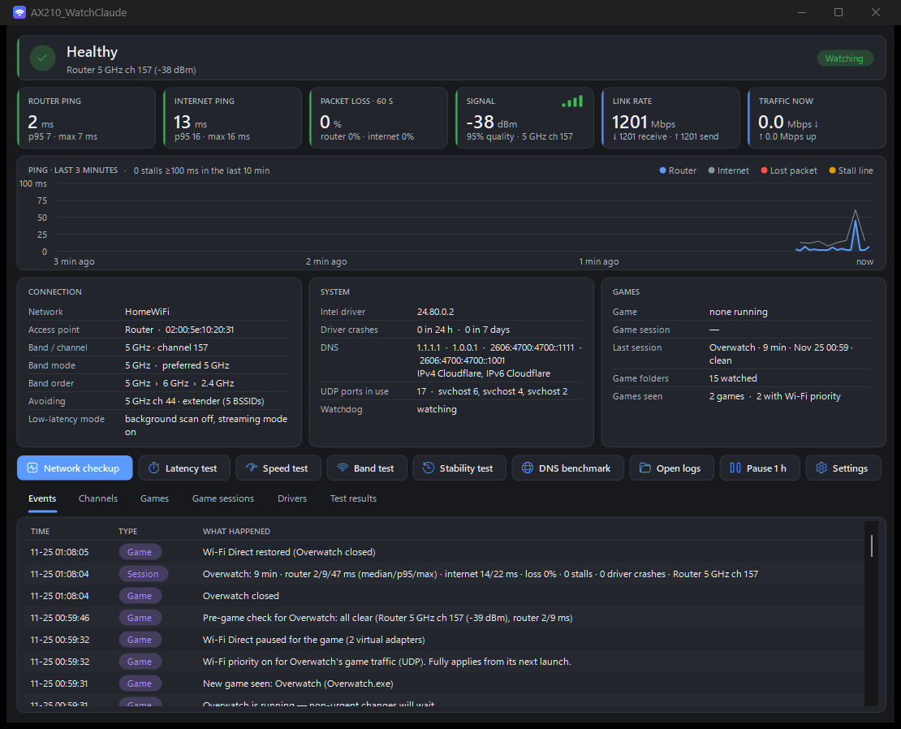
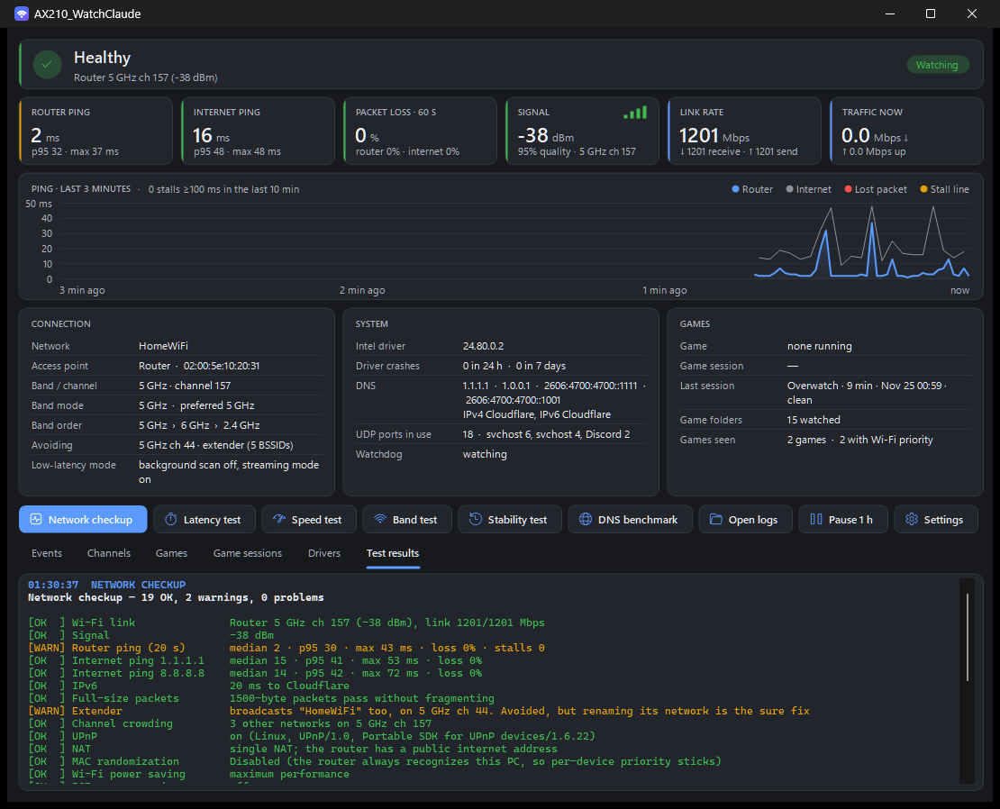
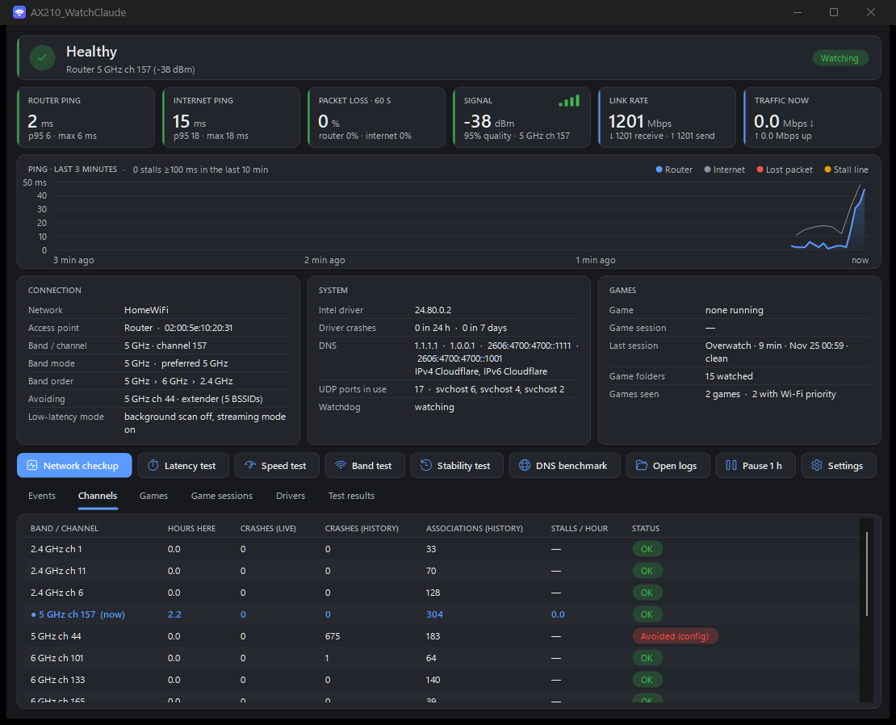
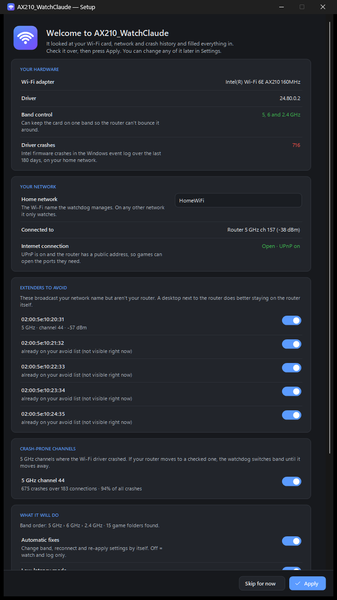
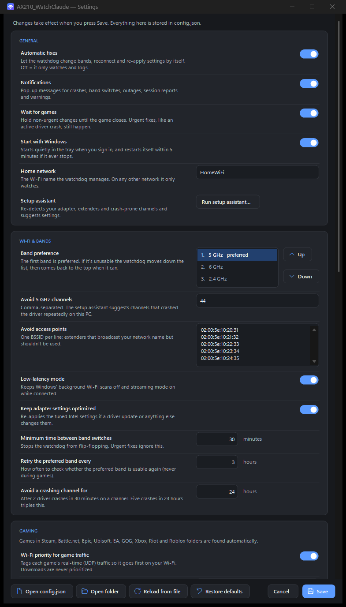

<p align="center">
  
</p>

<h1 align="center">AX210_WatchClaude</h1>

<p align="center">
  <b>A tray app that keeps an Intel AX210 Wi-Fi card steady for online gaming on Windows 11.</b><br>
  It watches the driver, works around its firmware crashes, keeps the card on the best band and access point, and gives game traffic priority.
</p>

<p align="center">
  <a href="https://github.com/minimalice92/AX210_WatchClaude/releases/latest"></a>
  
  
  <a href="LICENSE"></a>
</p>

<p align="center"></p>

---

## Why it exists

It started with one gaming PC with an Intel AX210. On a good day Overwatch sat at a steady 50–60 ms. On a bad day it swung between 80 and 150 ms, with rubber-banding and disconnects. Windows' event log showed why:

- **The card's firmware kept hanging.** There were 716 crashes in six months (`NMI_INTERRUPT_HOST`: the chip stops answering and the driver force-resets it). Each crash drops the connection for a second or two.
- **94% of those crashes happened on one busy 5 GHz channel (44).** Another 5 GHz channel on the same router had about 300 connections and no crashes at all.
- **The card hopped constantly.** It moved between 2.4, 5 and 6 GHz and onto a Wi-Fi extender that broadcast the same network name, and each hop meant a new path and new latency. On 6 GHz it also showed short silent stalls.

Windows and the Intel driver have no setting for "stay off that channel", "stay on the router, not the extender" or "don't wander off mid-match". AX210_WatchClaude adds them. It reads your own crash history to decide what to avoid, so it fits any PC with an AX210-family card, not just the one it was written on.

> The crash codes come from the open-source Linux driver (`iwlwifi`, `fw/img.c`), so the app can name the exact firmware error behind each crash.

## Features

### Stays on the right band, channel and access point

| | |
|---|---|
| **Band lock** | Keeps the card on one band (5 GHz by default) using Intel's own driver settings, so the router's band-steering can't bounce it around. Band order is configurable (for example 5 › 6 › 2.4 GHz). |
| **Crash-prone channels** | The setup assistant finds 5 GHz channels that crashed the driver repeatedly on *your* PC. If the router moves onto one, the app switches band and checks back every few hours. |
| **Automatic quarantine** | Any band/channel that crashes 2 times in 30 minutes, or 5 times in 24 hours, is avoided for 24–72 hours. |
| **Extender avoidance** | Detects access points that broadcast your network name but aren't your router (a different vendor prefix from the router's). Then it steers to the router's own radio with a targeted connect. |
| **Transactional changes** | Every band change is verified: right band, OK channel, router answering. If any check fails within 60 s, the previous setup is restored. |
| **Fast downloads on 6 GHz** *(optional)* | A big download with no game open temporarily uses 6 GHz's faster link, then returns. |

### Fixes and prevents drops

| | |
|---|---|
| **Live crash decoding** | Watches the Intel driver's event log as it happens. Each crash is decoded to its firmware error (`NMI_INTERRUPT_HOST`, `SYSASSERT`, …) and labelled with the band and channel it hit. |
| **Recovery ladder** | Pings the router every second and the internet every 2 s. If the link drops: reconnect at 8 s, full reconnect at 30 s, adapter restart at 60 s, roll back to the last setup that worked at 120 s. It tells a Wi-Fi problem apart from an ISP outage. |
| **Low-latency mode** | While connected, keeps Windows' background Wi-Fi scans off and "media streaming mode" on, so the card never goes off-channel to scan. |
| **Tuned adapter profile** | Lowest roaming aggressiveness, no packet coalescing, no MIMO/U-APSD power saving, CTS-to-self, max transmit power. Re-applied after driver updates. |
| **Power settings** | Wi-Fi power saving at maximum performance, PCIe link power management off, and "allow the computer to turn off this device" off. |
| **Driver scorecard and rollback** | Tracks crashes per connected hour for each driver version, and keeps a copy of the current driver. If an update turns out worse, it tells you and offers a one-click rollback. |

### Made for gaming

| | |
|---|---|
| **Finds your games** | Anything you play from Steam, Battle.net, Epic, Ubisoft, EA, GOG, Xbox, Riot or Roblox folders, including games installed later, plus about 40 popular online games by name. A program only counts once it has been in the foreground, so background tools never do. |
| **Game traffic priority** | Tags each game's real-time (UDP) traffic as voice priority (DSCP 46 / WMM voice), so it goes first on the Wi-Fi uplink. Downloads are never prioritized. It's a Windows network policy that never touches the game, so it's anti-cheat safe. |
| **Waits for your game** | Non-urgent changes wait until the game closes. Urgent fixes, like an active driver crash, still happen. |
| **Wi-Fi Direct paused** | Pauses the Wi-Fi Direct virtual adapters during games, so the card doesn't leave your channel looking for casting or hotspot devices. |
| **Pre-game check and session reports** | 15 s into each game it checks quietly and only speaks up if something is wrong. When the game closes you get a one-line report: ping, loss, stalls, crashes and where you were connected. |
| **Download warnings** | Tells you, by program name, when something on the PC downloads or uploads heavily during a game. |
| **Upload limiter** *(optional)* | Caps non-game uploads just below your line speed so big uploads don't add lag. |

### Tests and diagnostics

<p align="center"></p>

| | |
|---|---|
| **Network checkup** | About 25 checks graded OK, WARN or FAIL: link, signal, router and internet ping, IPv6, MTU, extenders, channel crowding, UPnP and NAT type, MAC randomization, power settings, TCP, Wi-Fi Direct, low-latency mode, adapter profile, game priority, driver, DNS, UDP ports, and more. |
| **Latency test** | 30 s at 4 pings/s to the router, 1.1.1.1 and 8.8.8.8, with percentiles and stalls. |
| **Speed test** | Download and upload speed, plus latency under load (a bufferbloat grade). |
| **Band test** | About a minute on each band, scored. The winner becomes your preferred band. |
| **Stability test** | 10 minutes of pings plus download bursts, counting crashes, loss and stalls. |
| **DNS benchmark** | Cloudflare, Google, Quad9, OpenDNS and AdGuard over IPv4 and IPv6. It switches only for a clear win (at least 2 ms and 10% faster). |
| **History** | Per-channel table (hours, crashes, stalls), game list, game sessions, driver versions, and a full event timeline. |
| **UDP port watch** | Warns before Windows runs out of UDP ports (Tcpip 4266) and names the app using them. |

<p align="center"></p>

### Set up for you

<p align="center">
  
  &nbsp;
  
</p>

- **Setup assistant.** On first run it detects your adapter, driver and what it supports (band locking, 6 GHz), your home network, likely extenders, crash-prone channels from your own event log, and your NAT/UPnP status. Everything is filled in; you review it and press Apply. You can run it again any time.
- **Settings window.** Every option has plain-English help, toggles, validation and live apply, plus a button to open the raw `config.json`.
- **Follows Windows light/dark mode.** The app, tray menu and installer all switch with it.

## Install

1. Download **`AX210_WatchClaude-Setup-x.y.z.exe`** from [Releases](https://github.com/minimalice92/AX210_WatchClaude/releases/latest).
2. Run it and click **Yes** on the Windows prompt. *Start with Windows* and *Desktop shortcut* are pre-checked.
3. The app opens with the setup assistant. Check it over and press **Apply**.

After that it lives in the tray (the Wi-Fi icon by the clock). The icon turns amber for a warning and red for a problem. Left-click for the status window; right-click for tests and options.

> **Why does it need admin rights?** Changing adapter settings, power settings and traffic priority needs them. The installer creates a scheduled task that starts the app with those rights when you sign in, so you never see a UAC prompt after installing. The task also restarts the app within 5 minutes if it ever stops. *Exit* in the tray menu means "off until next sign-in".

**Uninstall** from *Settings → Apps*, like any other app. It asks whether to put your adapter and DNS settings back the way they were (on by default) and whether to delete its logs and settings (off by default).

### Compatibility

| | |
|---|---|
| **Best on** | Intel AX210 / AX211 / AX411 (Wi-Fi 6E) on Windows 11 with Intel's driver |
| **Also works on** | Other Intel Wi-Fi 6/6E/7 cards (AX200, AX201, BE200…). Features adapt: no 6 GHz means 5 and 2.4 GHz only. |
| **Other brands** | Monitoring, low-latency mode, game priority, tests and the checkup work. Band locking is Intel-only, so it stays off. |
| **Needs** | Windows 10 1809+ or Windows 11, .NET Framework 4.8 (built into both) |

## How it works

<details>
<summary><b>Reading the crash codes</b></summary>

Every firmware crash writes events 5002/5005 from the `Netwtw14` provider to the System log. The event's binary data is an `IO_ERROR_LOG_PACKET`. After its 40-byte header, word 0 is the firmware error ID, for example `0x20000066`. With the top nibble masked off that is `0x66`, which Intel's Linux driver names `NMI_INTERRUPT_HOST`: the firmware stopped responding and the driver forced a reset. Word 4 is the code address where the firmware was stuck.

Event 7021 is logged at every association. It carries the BSSID (8 bytes before the SSID) and the channel (84 bytes after it). Matching each crash to the association before it gives a crash count per band and channel, going back about 180 days. That is what the setup assistant and the Channels tab show.
</details>

<details>
<summary><b>Band locking and steering</b></summary>

Band control uses the Intel driver's own advanced properties:

- `WirelessMode`: 17 = 5 GHz only, 32 = 2.4 GHz only
- `Is6GhzBandSupported`
- `RoamingPreferredBandType`

They are applied with `Set-NetAdapterAdvancedProperty`, and the app verifies the result before keeping it. To steer between access points it calls `WlanConnect` from the Native Wi-Fi API with a desired-BSSID list, so it can pick the router's own radio over an extender that uses the same network name. Low-latency mode uses `WlanSetInterface` (background scan off, streaming mode on). Windows resets both whenever no app holds them.
</details>

<details>
<summary><b>Game traffic priority</b></summary>

For each game it adds a Windows QoS policy: `New-NetQosPolicy -AppPathNameMatchCondition <game.exe> -IPProtocolMatchCondition UDP -DSCPAction 46`. The Wi-Fi driver maps DSCP 46 to the WMM *voice* queue. Only the game's UDP packets are tagged (that is its real-time traffic), never TCP downloads. The policies are named `AX210_WatchClaude_<game>` and are removed on uninstall.
</details>

## Files

| | |
|---|---|
| `C:\Program Files\AX210_WatchClaude\` | the app |
| `C:\ProgramData\AX210_WatchClaude\config.json` | settings (also editable in the Settings window) |
| `…\state.json` | learned data: your original settings (for restore), quarantines, per-channel stats, games |
| `…\status.json` | live snapshot, updated every 5 s |
| `…\logs\watch.log` | timeline of everything it saw and did |
| `…\logs\benchmarks.log`, `logs\sessions.csv` | test results; one line per game session |
| `…\samples\YYYY-MM-DD.csv` | a 5-second record of band, channel, signal, ping and loss (kept 14 days) |
| `…\driver-backup\<version>\` | saved driver packages for rollback |

Only administrators can change the data folder. The settings drive an elevated app, so standard users get read-only access.

## Privacy

Everything stays on your PC. There's no telemetry, no account and no cloud service. The only network traffic is what the tests themselves need: pings, DNS queries, the speed test (Cloudflare's speed endpoints) and a UPnP query to your own router.

## Build from source

You need Visual Studio 2019+ or the Build Tools (for the Roslyn C# compiler and .NET Framework 4.8), plus [Inno Setup 6.4+](https://jrsoftware.org/isinfo.php) for the installer (`winget install JRSoftware.InnoSetup`).

```powershell
.\build.ps1            # icon + installer art, the app, and dist\AX210_WatchClaude-Setup-<version>.exe
.\build.ps1 -AppOnly   # just build\AX210_WatchClaude.exe
```

| Source | |
|---|---|
| `src\AX210_WatchClaude.cs` | watchdog core: Wi-Fi API, adapter control, ping monitor, crash decoder, games, DNS, tests, tray |
| `src\Features.cs` | game sessions, Wi-Fi Direct, driver scorecard/rollback, upload limiter, network checkup |
| `src\UI.cs`, `src\Settings.cs`, `src\Setup.cs` | status window, settings, setup assistant, installer hooks |
| `src\Brand.cs`, `tools\MakeAssets.cs` | the icon and installer artwork, drawn in code |
| `installer\AX210_WatchClaude.iss` | Inno Setup script |

Handy switches: `--selftest <file> [--checkup]` writes a read-only diagnostic report, and `--render <png> [view] [--redact]` renders a window to an image (this is how the screenshots above were made, with network names and MAC addresses masked).

## Credits

Written by Claude (Anthropic) with [minimalice92](https://github.com/minimalice92), from one gaming PC's event logs. Firmware error names come from the Linux `iwlwifi` driver.

Not affiliated with Intel. Use at your own risk. Every change it makes can be reverted from the tray menu or the uninstaller.

MIT licensed, see [LICENSE](LICENSE).
